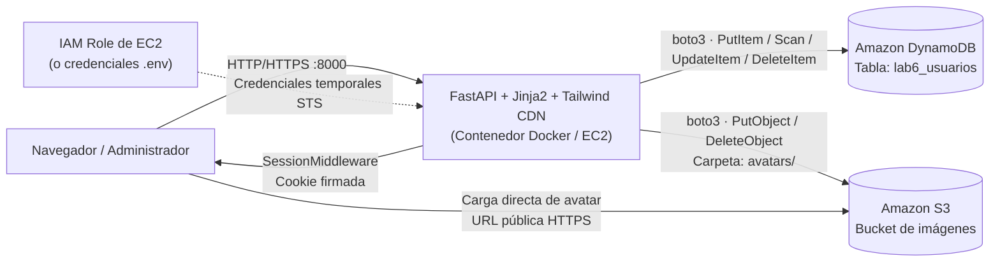

# CloudAdmin · Gestión de Usuarios en la Nube

Aplicación web ligera y modular desarrollada para el laboratorio **"Desarrollo de aplicación usando servicios en la nube"**. Permite administrar usuarios mediante un panel web protegido con autenticación por sesión firmada, almacenando los datos estructurados en **Amazon DynamoDB** y las fotos de perfil en **Amazon S3**.

---

## Arquitectura



### Flujo principal
1. El administrador inicia sesión en `/login` usando `ADMIN_USER` y `ADMIN_PASSWORD`. La sesión queda protegida con `SessionMiddleware` (`itsdangerous`) en una cookie firmada `HttpOnly`.
2. Todas las rutas del panel (`/`, `/users`, `/users/{id}/edit`, `/users/{id}/delete`) redirigen automáticamente a `/login` si no hay sesión activa.
3. Al registrar o actualizar un usuario con foto de perfil, el backend valida extensión (`.jpg`, `.jpeg`, `.png`, `.webp`), tipo MIME, firma real de bytes (magic bytes) y tamaño máximo (**3 MB**) antes de subir el archivo a `avatars/<uuid>.<ext>` en S3.
4. La URL pública de S3 y los metadatos del usuario se guardan en DynamoDB con llave primaria `user_id` (UUID v4).
5. Al reemplazar una foto o eliminar un usuario, la aplicación elimina también el objeto asociado en Amazon S3 para evitar archivos huérfanos.

---

## Estructura del proyecto

```text
.
├── app/
│   ├── __init__.py
│   ├── main.py              # Rutas FastAPI, autenticación por sesión y lógica CRUD
│   ├── aws_service.py       # Integración aislada con DynamoDB y S3 (boto3) + validación
│   └── templates/
│       ├── login.html       # Pantalla de inicio de sesión
│       ├── index.html       # Panel principal (estadísticas, creación, búsqueda y tabla)
│       └── edit.html        # Edición de usuario y reemplazo/eliminación de avatar
├── requirements.txt         # Dependencias Python
├── Dockerfile               # Imagen optimizada basada en python:3.11-slim (usuario no-root)
├── docker-compose.yml       # Orquestación local/EC2 con carga de .env
├── .env.example             # Plantilla de variables de entorno
├── .gitignore               # Exclusión de secretos, caché y entornos virtuales
└── README.md                # Documentación técnica y guía de despliegue
```

---

## Requisitos previos

- **Python 3.11** (para ejecución local) o **Docker + Docker Compose** (para ejecución contenerizada).
- Una cuenta de **AWS** con los siguientes recursos creados:
  1. **Tabla Amazon DynamoDB**:
     - Nombre por defecto: `lab6_usuarios` (configurable vía `DYNAMODB_TABLE`).
     - Partition Key (Clave de partición): `user_id` de tipo **String**.
  2. **Bucket Amazon S3**:
     - Nombre único global (configurado en `S3_BUCKET_NAME`).
     - Acceso público habilitado únicamente para lectura de objetos bajo `avatars/*` mediante **Bucket Policy**, para que el navegador pueda renderizar las fotos de perfil guardadas en DynamoDB.

### Política recomendada para el Bucket S3 (lectura pública de avatares)

En la consola de S3, dentro de **Permisos → Bloqueo de acceso público**, desactiva el bloqueo de políticas públicas (manteniendo seguras las ACLs si lo deseas) y agrega esta **Bucket Policy** reemplazando `TU-BUCKET-NAME`:

```json
{
  "Version": "2012-10-17",
  "Statement": [
    {
      "Sid": "PublicReadAvatars",
      "Effect": "Allow",
      "Principal": "*",
      "Action": "s3:GetObject",
      "Resource": "arn:aws:s3:::TU-BUCKET-NAME/avatars/*"
    }
  ]
}
```

### Política IAM mínima recomendada (para EC2 IAM Role o usuario IAM)

```json
{
  "Version": "2012-10-17",
  "Statement": [
    {
      "Sid": "DynamoDBUsersCRUD",
      "Effect": "Allow",
      "Action": [
        "dynamodb:Scan",
        "dynamodb:GetItem",
        "dynamodb:PutItem",
        "dynamodb:UpdateItem",
        "dynamodb:DeleteItem"
      ],
      "Resource": "arn:aws:dynamodb:us-east-1:TU-ACCOUNT-ID:table/lab6_usuarios"
    },
    {
      "Sid": "S3AvatarsReadWriteDelete",
      "Effect": "Allow",
      "Action": [
        "s3:PutObject",
        "s3:DeleteObject",
        "s3:GetObject"
      ],
      "Resource": "arn:aws:s3:::TU-BUCKET-NAME/avatars/*"
    }
  ]
}
```

---

## Variables de entorno

Copia `.env.example` a `.env` y ajusta los valores:

| Variable | Obligatoria | Valor por defecto | Descripción |
| --- | --- | --- | --- |
| `AWS_REGION` | Sí | `us-east-1` | Región donde residen DynamoDB y S3. |
| `S3_BUCKET_NAME` | Sí | — | Nombre del bucket S3 donde se guardarán las fotos en `avatars/`. |
| `DYNAMODB_TABLE` | No | `lab6_usuarios` | Nombre de la tabla DynamoDB con PK `user_id`. |
| `ADMIN_USER` | Sí | — | Usuario administrador para iniciar sesión en `/login`. |
| `ADMIN_PASSWORD` | Sí | — | Contraseña del administrador. |
| `SECRET_KEY` | Sí | Aleatoria en memoria | Clave secreta para firmar las cookies de sesión (`itsdangerous`). |
| `AWS_ACCESS_KEY_ID` | Opcional | — | Clave de acceso AWS (omitir en EC2 con IAM Role). |
| `AWS_SECRET_ACCESS_KEY` | Opcional | — | Clave secreta AWS (omitir en EC2 con IAM Role). |
| `AWS_SESSION_TOKEN` | Opcional | — | Token temporal (útil en entornos como AWS Academy Learner Lab). |

> **Nota sobre credenciales:** Si `AWS_ACCESS_KEY_ID` y `AWS_SECRET_ACCESS_KEY` están comentadas o vacías, `boto3` utiliza automáticamente la cadena estándar de credenciales de AWS, incluyendo el **IAM Role asignado a la instancia EC2**.

---

## Ejecución local (sin Docker)

```bash
# 1. Crear y activar entorno virtual con Python 3.11
python3.11 -m venv .venv
source .venv/bin/activate        # En Windows PowerShell: .venv\Scripts\Activate.ps1

# 2. Instalar dependencias
pip install -r requirements.txt

# 3. Configurar variables de entorno
cp .env.example .env
# Edita .env con tus valores reales

# 4. Iniciar servidor FastAPI
uvicorn app.main:app --host 0.0.0.0 --port 8000 --reload
```

Accede en tu navegador a `http://localhost:8000`.

---

## Ejecución con Docker y Docker Compose

```bash
# 1. Preparar variables de entorno
cp .env.example .env
# Edita .env con tu bucket, tabla y credenciales de panel

# 2. Construir e iniciar el contenedor
docker compose up -d --build

# 3. Ver logs en tiempo real
docker compose logs -f

# 4. Detener el servicio
docker compose down
```

También puedes construir y ejecutar directamente con Docker CLI:

```bash
docker build -t cloudadmin-app .
docker run -d --name cloudadmin-web -p 8000:8000 --env-file .env cloudadmin-app
```

---

## Despliegue en Amazon EC2 (con IAM Role)

1. **Lanzar la instancia EC2**:
   - AMI recomendada: **Amazon Linux 2023** o **Ubuntu 24.04 LTS**.
   - Asigna un **IAM Role** a la instancia con permisos sobre tu tabla DynamoDB y bucket S3 (sin necesidad de guardar `AWS_ACCESS_KEY_ID` ni `AWS_SECRET_ACCESS_KEY` en el servidor).
   - En el **Security Group**, habilita tráfico entrante TCP en el puerto `8000` (y `22` para SSH, idealmente restringido a tu IP).
2. **Habilitar salto IMDSv2 para Docker** (recomendado si la instancia exige IMDSv2):
   - Al usar contenedores Docker en EC2, el acceso al servicio de metadatos requiere un salto de red adicional (`HopLimit = 2`). Desde AWS CLI o la configuración de instancia:
     ```bash
     aws ec2 modify-instance-metadata-options \
       --instance-id i-xxxxxxxxxxxxxxxxx \
       --http-put-response-hop-limit 2 \
       --http-endpoint enabled
     ```
3. **Instalar Docker y desplegar**:
   ```bash
   # Ejemplo en Ubuntu / Amazon Linux
   git clone <URL_DE_TU_REPOSITORIO>
   cd <CARPETA_DEL_PROYECTO>

   cp .env.example .env
   nano .env   # Configura S3_BUCKET_NAME, DYNAMODB_TABLE, ADMIN_USER, ADMIN_PASSWORD y SECRET_KEY
               # Deja AWS_ACCESS_KEY_ID y AWS_SECRET_ACCESS_KEY comentadas

   docker compose up -d --build
   ```
4. **Verificar estado**:
   - Endpoint de salud: `http://<IP_PUBLICA_EC2>:8000/health` debe responder `{"status":"ok"}`.
   - Panel web: `http://<IP_PUBLICA_EC2>:8000/login`.
